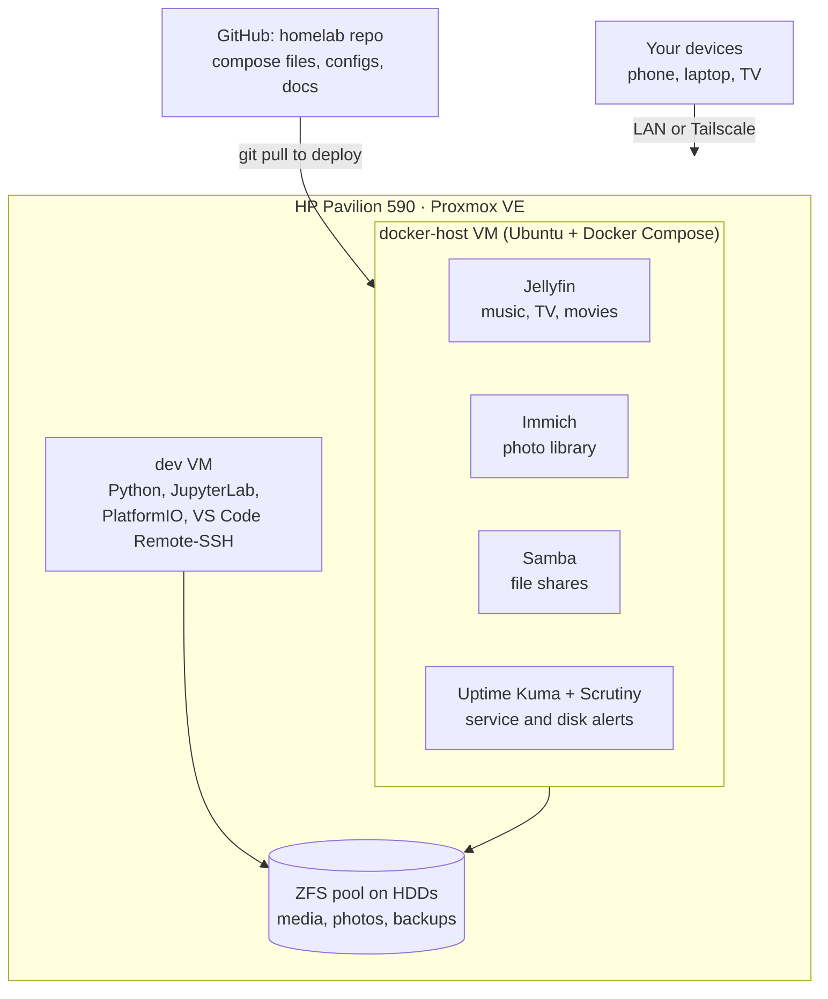

# my homelab!

currently, this is an HP office PC turned into a Proxmox VE server, with intent to upgrade hardware. The plan is one host running two VMs, one being a Docker host for services, the other being a dev box for ML and embedded work. this repo exists for a few main reasons: to track everything in the lab, to contain every upgrade, change, and/or issue I've ran into, and to allow the whole lab to be rebuilt if need be

> **status as of 11/4/26:** Proxmox is installed and the server is running headless. web UI is working on LAN and remotely via Tailscale. my next steps are to move the install from the HDD to a new NVMe SSD and to add more RAM.

## target architecture..



## current HW

**HP Pavilion Desktop 590-p0xxx** (mini tower)

| Part      | Installed                                   | Upgrade room                                              |
| --------- | ------------------------------------------- | --------------------------------------------------------- |
| CPU       | Intel Core i3-8100 (4 cores, UHD 630 with Quick Sync) | LGA1151, H370 chipset: 8th/9th-gen i5/i7        |
| RAM       | 8 GB DDR4 (1 stick)                         | 2 slots, 32 GB max                                        |
| Storage   | 1 TB HDD (Proxmox is on it for now)         | Free M.2 2280 (NVMe), free 2.5" bay, 5.25" bay            |
| Expansion | None                                        | PCIe x16 and PCIe x1, both free                           |
| Network   | Gigabit ethernet                            | Wi-Fi card in M.2 2230 (Proxmox doesn't use it)           |
| PSU       | 180 W or 310 W (label not checked yet)      | Decides whether a slot-powered GPU will fit               |

**upgrades OTW:** 1 TB NVMe SSD, a second 8 GB DDR4 stick

## network setup

| setting      | val                                      |
| ------------ | ---------------------------------------- |
| host         | `pve.home.arpa`, static IPv4 on the LAN  |
| management   | Proxmox web UI on port `8006`            |
| remote       | Tailscale on the Proxmox host. no ports are forwarded on the router |
| connection   | ethernet only |

## progress so far

- [x] hardware inventory
- [x] Proxmox VE 9 installed with a static IP & web UI reachable
- [x] changed to the no-subscription update repo and updated
- [x] running headless in its permanent physical spot in my apt
- [x] tailscale remote access working
- [ ] NVMe and RAM upgrade & Proxmox reinstalled on the drive
- [ ] check bios is updated, VT-x/VT-d on, and After Power Loss is On
- [ ] check servers IP is reserved in my routers DHCP settings
- [ ] admin user with SSH keys & SSH password login turned off
- [ ] check temperatures under load
- [ ] `docker-host` VM up with Docker installed
- [ ] ZFS pool created and mounted
- [ ] jellyfin streaming to the tv
- [ ] phone photos backing up to immich
- [ ] `dev` VM reachable from vscode
- [ ] monitoring and nightly backups running & one restore tested

## planned services 


| order | service                   | where        | why                                             |
| ----- | ------------------------- | ------------ | ----------------------------------------------- |
| 1     | Tailscale                 | Proxmox host | remote access                    (**done**)     |
| 2     | Samba                     | docker-host  | network shares and PC backups                   |
| 3     | Jellyfin                  | docker-host  | media streaming w transcoding                   |
| 4     | Immich                    | docker-host  | photo library with phone auto backup            |
| 5     | Uptime Kuma + Scrutiny    | docker-host  | service uptime alerts and disk SMART health     |
| 6     | JupyterLab + PlatformIO   | dev VM       | ML notebooks & my ESP32 project builds over USB passthrough |
| Later | Portainer, Home Assistant, Gitea, a local LLM | tbd | extras once the basics are stable |

## roadblocks thus far

full write-ups will go in `docs/runbooks/` later

| issue | cause | fix |
| ------- | ----- | --- |
| Installer aborted: `Unable to set up timer: out of range` | the BIOS clock had a badly wrong date (i hadn't used this pc since I bought it secondhand. it had the year set to 2177 lol) which broke the DHCP timers. | i set the date and time in the BIOS (F10) then reran the installer. luckily the cmos battery wasn't dead, which was what i was worried about. |
| installer pre filled an IPv6 address | the ISP hands out IPv6, and the installer picked it up | i entered a static IPV4 address in the LAN subnet by hand after pinging it to check it was free |
| `apt update` returned `401 Unauthorized` from `enterprise.proxmox.com` | a fresh install turns on the paid enterprise repos | I disabled the `pve` and `ceph-squid` enterprise repos and added the No-Subscription repo. |

## planned repo layout 

```
homelab/
├── README.md
├── docs/
│   ├── hardware.md        # inventory and upgrade log
│   ├── network.md         # IPs, Tailscale names
│   └── runbooks/          # "how I fixed X" notes
├── proxmox/
│   └── vms.md             # VM specs (cores, RAM, disks)
├── stacks/                # one folder per Docker Compose stack
│   ├── samba/compose.yml
│   ├── jellyfin/compose.yml
│   ├── immich/compose.yml
│   └── monitoring/compose.yml
├── scripts/               # setup and backup scripts
├── .env.example           # variable names, no real values
└── .gitignore             # ignores .env and data folders
```
